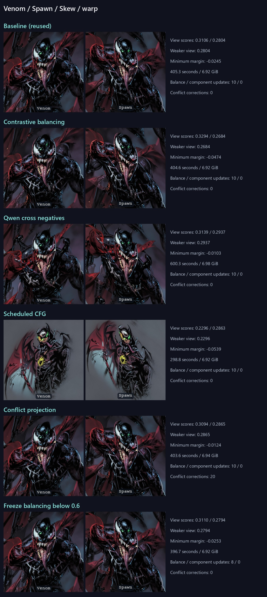
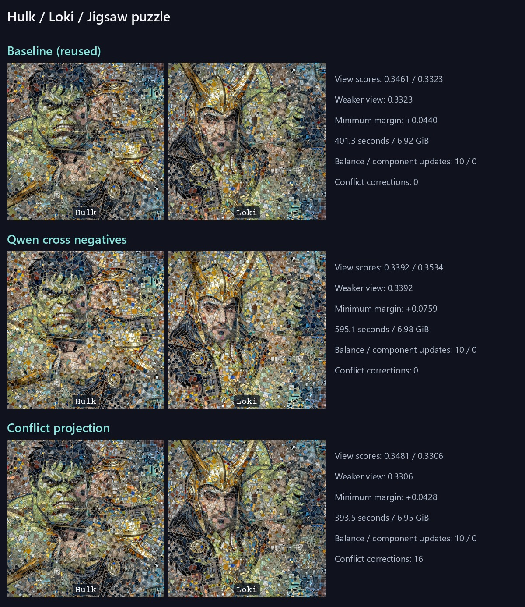
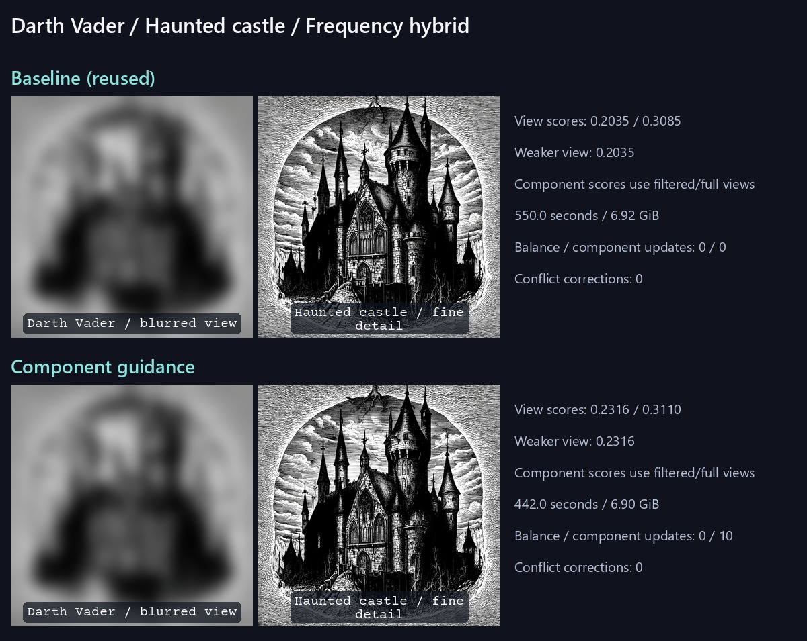
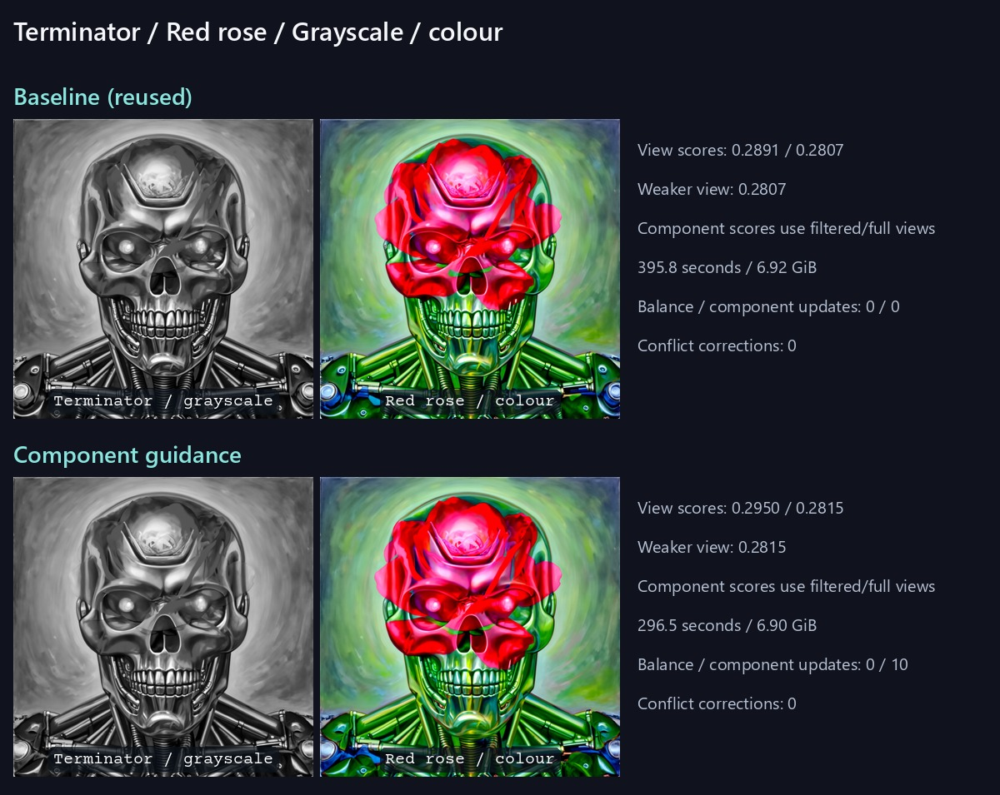

# Iris quality experiments: Standard 30 steps

9 new completed images; four verified cached baselines. RTX 3060 12 GB. No new rotation runs.
All images use 1024 x 1024, guidance 3, shift 8 and DPM order 2. Same prompts, seed and view mapping within each case. Geometric controls use Adaptive Mean; components use Classic Sum. Each trial changes one option.

A is the weaker intended-view CLIP cosine similarity. M is the minimum own-minus-other prompt margin. Higher is better for both, but neither establishes human illusion quality. Component subjects can coexist, so M is not a selection criterion for components. Inspect the filtered/full views as well as scores.

## Venom / Spawn

- a dramatic dark comic book portrait of Venom, a black symbiote with large white eyes, sharp teeth and a long tongue
- a dramatic dark comic book portrait of Spawn, a black masked antihero with glowing green eyes and a flowing red cape

| Option | View 1 | View 2 | A | M | Seconds | Peak GiB |
| --- | ---: | ---: | ---: | ---: | ---: | ---: |
| Baseline (reused) | 0.3106 | 0.2804 | 0.2804 | -0.0245 | 405.3 | 6.92 |
| Contrastive balancing | 0.3294 | 0.2684 | 0.2684 | -0.0474 | 404.6 | 6.92 |
| Qwen cross negatives | 0.3139 | 0.2937 | 0.2937 | -0.0103 | 600.3 | 6.98 |
| Scheduled CFG | 0.2296 | 0.2863 | 0.2296 | -0.0539 | 298.8 | 6.92 |
| Conflict projection | 0.3094 | 0.2865 | 0.2865 | -0.0124 | 403.6 | 6.94 |
| Freeze balancing below 0.6 | 0.3110 | 0.2794 | 0.2794 | -0.0253 | 396.7 | 6.92 |

## Hulk / Loki

- a colorful mosaic portrait of the Hulk, an angry green face with black hair
- a colorful mosaic portrait of Loki wearing a golden horned helmet

| Option | View 1 | View 2 | A | M | Seconds | Peak GiB |
| --- | ---: | ---: | ---: | ---: | ---: | ---: |
| Baseline (reused) | 0.3461 | 0.3323 | 0.3323 | +0.0440 | 401.3 | 6.92 |
| Qwen cross negatives | 0.3392 | 0.3534 | 0.3392 | +0.0759 | 595.1 | 6.98 |
| Conflict projection | 0.3481 | 0.3306 | 0.3306 | +0.0428 | 393.5 | 6.95 |

## Darth Vader / Haunted castle

- a high contrast monochrome gothic engraving of Darth Vader's helmet, a large centered symmetrical face
- a high contrast monochrome gothic engraving of a haunted castle with many pointed towers and intricate windows

| Option | View 1 | View 2 | A | M | Seconds | Peak GiB |
| --- | ---: | ---: | ---: | ---: | ---: | ---: |
| Baseline (reused) | 0.2035 | 0.3085 | 0.2035 | — | 550.0 | 6.92 |
| Component guidance | 0.2316 | 0.3110 | 0.2316 | — | 442.0 | 6.90 |

## Terminator / Red rose

- a detailed surreal oil painting of the Terminator's chrome robotic skull, a large centered face
- a detailed surreal oil painting of a blooming red rose with vivid green leaves

| Option | View 1 | View 2 | A | M | Seconds | Peak GiB |
| --- | ---: | ---: | ---: | ---: | ---: | ---: |
| Baseline (reused) | 0.2891 | 0.2807 | 0.2807 | — | 395.8 | 6.92 |
| Component guidance | 0.2950 | 0.2815 | 0.2815 | — | 296.5 | 6.90 |

## Default decision

Standard paired geometric Auto/Mean views with Adaptive balancing now use Qwen cross negatives at strength 0.5. Component guidance is enabled for Standard low/high-frequency and grayscale/colour pairs with Classic Sum. The base profile remains Standard 30 steps, CFG 3, shift 8 and DPM order 2. Other new experiments remain off; Turbo and untested component groups keep their previous settings. Explicit user overrides always win.

- Component guidance: both intended-view scores improved on the Vader/castle case (0.2035/0.3085 to 0.2316/0.3110). The blurred helmet is clearer and the detailed castle remains readable.
- Component guidance: Terminator/rose scores changed from 0.2891/0.2807 to 0.2950/0.2815. The rose-view gain is negligible; visual review found no material regression. Both component implementations use one shared reference prediction instead of two.
- Contrastive balancing: rejected for default promotion in this screen. Warp weaker-view alignment fell from 0.2804 to 0.2684 and minimum prompt margin worsened from -0.0245 to -0.0474; both views still favour Venom.
- Scheduled CFG: rejected at the tested interval. Warp weaker-view alignment fell to 0.2296, with visibly weaker Venom detail despite faster sampling.
- Balance freeze: leave disabled. Freeze below 0.6 suppressed the last two balancing updates but gave almost no perceptual difference and slightly lower weaker-view alignment (0.2794).
- Qwen cross negatives: promoted after both geometric cases improved weaker-view alignment and minimum prompt margin. Warp A/M changed from 0.2804/-0.0245 to 0.2937/-0.0103; jigsaw changed from 0.3323/+0.0440 to 0.3392/+0.0759. The warp still favours Venom in both views; the jigsaw still separates the faces spatially. These are modest recognition gains, not proof of a convincing illusion.
- Cross negatives at strength 0.5 cost six model forwards instead of four per guided step, approximately 50% more sampling work. They reuse the bundled Qwen encoder for planning, with no extra LLM weights. Invalid default/GUI planning logs and records a fallback to shared negatives; explicit CLI planning remains strict unless --negative_fallback is set.
- Conflict projection: leave disabled. Its warp improvement did not repeat on the jigsaw, where weaker-view alignment fell from 0.3323 to 0.3306 and margin from +0.0440 to +0.0428. Images were visually almost unchanged.
- This small pilot tests each option independently, one seed per case. Combinations were not benchmarked. New geometric defaults generalise from warp/jigsaw to paired Adaptive geometry; no new rotations were generated. Motion, triple-component and scale groups were not tested here.

## Conditions

Held-out CLIP ViT-L/14 scores saved clean pixels. Generation uses CPU CLIP ViT-B/32 where applicable; these are related evaluator families. Human review is required, especially for subject segregation and artifacts.
The initial screen tests contrastive balancing, Qwen cross negatives (strength 0.5), scheduled CFG (noise interval 0.1–0.9, ramps 0.05), conflict projection (strength 0.5), freeze below noise 0.6, and component guidance. At 30 steps / shift 8, the lowest model-evaluation noise is about 0.216: freeze 0.1 has no effect, whereas freeze 0.6 suppresses the final two balancing updates.
Times exclude encoding, loading, warm-up, saving and evaluation. Baseline times come from the earlier runs; treat runtime differences as approximate. Trials are a small pilot, not a universal ranking.
[Full settings, schedules, hashes and scores](results.json). [Qwen plans](negative-plans.json).

Reproduce the screen with `python scripts/benchmark_quality_experiments.py`; repeat selected geometric options on the jigsaw using `--confirm contrastive` (or other option IDs). The verified source runs and prompt caches named in the plan are required. Publish completed trials with `python scripts/report_quality_experiments.py`.
