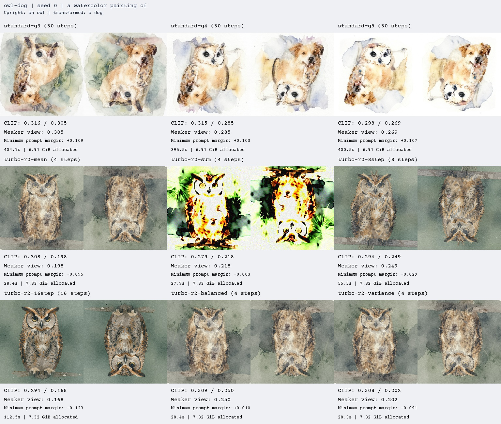
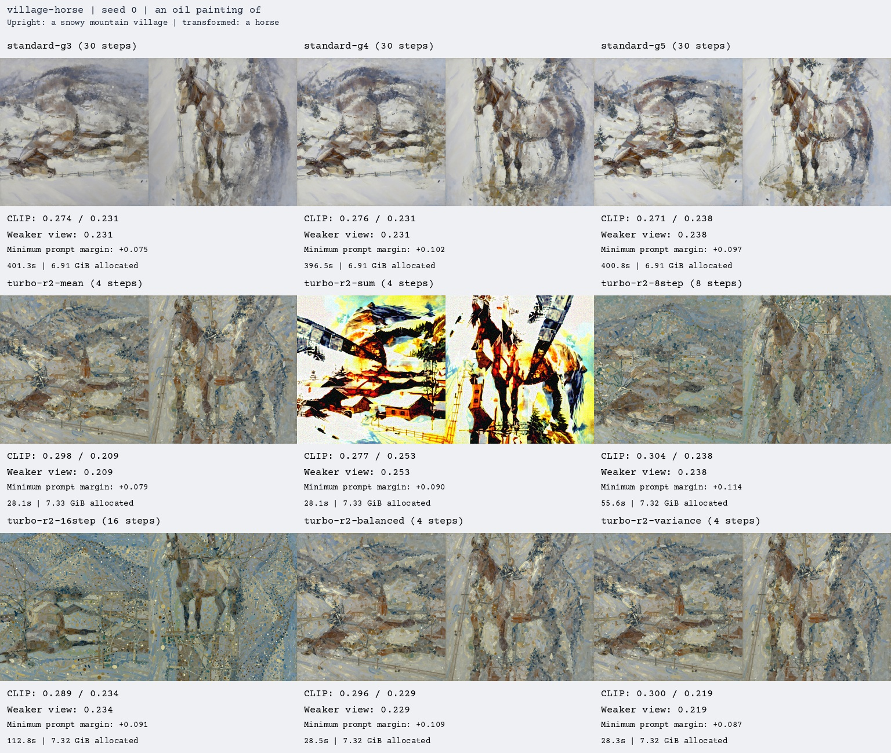

# Iris Standard/Turbo quality pilot

These results led to the current **Standard Iris / 30 steps / guidance 3 / Auto**
defaults. Auto uses Mean for the rotation views tested here. Turbo r2 remains
available as a fast option.

The pilot completed 18 generations on an RTX 3060 12 GB at 1024 × 1024 with
the same INT8 base and cached prompt embeddings. Every setting used seed 0
on both prompt pairs; no best-seed selection was performed:

- Watercolor **owl / dog**, with a 180-degree rotation.
- Oil painting **snowy mountain village / horse**, with a clockwise quarter-turn.

## Scores and timings

Each score is the mean across the two pairs of the weaker view's CLIP cosine
similarity. Higher means stronger prompt alignment, not necessarily a more
convincing illusion or prettier image. B/32 guided only the adaptive experiment;
L/14 was held out from generation. Both are from the CLIP family. These numbers
are not comparable to the papers' benchmark datasets.

| Method | CLIP B/32 | CLIP L/14 (held out) | Mean generation time |
| --- | ---: | ---: | ---: |
| Standard, 30 steps, guidance 3 | 0.3068 | **0.2683** | 403 s |
| Standard, 30 steps, guidance 4 | **0.3114** | 0.2582 | 396 s |
| Standard, 30 steps, guidance 5 | 0.2962 | 0.2536 | 401 s |
| Turbo r2, 4 steps, Mean | 0.2543 | 0.2038 | 28 s |
| Turbo r2, 8 steps, Mean | 0.2777 | 0.2435 | 56 s |
| Turbo r2, 16 steps, Mean | 0.2540 | 0.2010 | 113 s |
| Turbo r2, 4 steps, preview balancing | 0.2912 | 0.2397 | 28 s |
| Turbo r2, 4 steps, bounded variance correction | 0.2551 | 0.2106 | 28 s |
| Turbo r2, 4 steps, Sum control | 0.2427 | 0.2357 | 28 s |

Times exclude encoding, model/scorer loading, one warm-up forward, saving,
and final scoring. Adaptive image scoring during generation is included.
Peak PyTorch allocations were about 6.91 GiB for Standard and 7.32–7.33 GiB
for Turbo, excluding other desktop applications. These are measured allocations,
not minimum hardware requirements.

## All methods, both views





## Interpretation and limits

Standard had stronger overall alignment than the four-step Turbo baseline.
Guidance 3 won on the held-out evaluator; guidance 4 won on B/32. Guidance 5
did not improve the mean on either. Some Standard images still separate the
subjects into different areas, which a high CLIP score does not penalize reliably.

Adaptive balancing is the most promising inexpensive calculation change in this
pilot: both evaluators improved on both pairs relative to four-step Mean. It
used approximately 40/60 owl/dog weights and 44/56 village/horse weights after
scoring a clean preview. It needs an additional CPU CLIP model, and remains
an isolated research option rather than a GUI setting.

Eight Turbo steps improved held-out alignment for both pairs. Sixteen steps
strongly favored the owl and lost the dog. The adapter was trained for four
steps, so longer schedules are experiments, not guaranteed quality upgrades.

The bounded variance correction applied gains of only about 1.00002–1.00015,
because the aligned noise estimates were highly correlated. Its effect was
small. The Sum controls were severely overexposed, even where CLIP rewarded
their recognizable shapes. Use Auto/Mean for geometric views.

This is a small pilot with **one seed per pair**. It does not establish
statistical significance, universal best settings, or superiority over
DeepFloyd. Puzzles, factorized components, additional seeds, 100-step Standard,
attention-overlap guidance, and SyncVC were not tested here. Turbo puzzle
examples exist in the [showcase](../showcase/README.md), but there is no paired
Standard/Turbo puzzle benchmark yet.

## Reproduce and inspect

From the project folder:

```powershell
.\.venv\Scripts\python.exe scripts/benchmark_quality.py
.\.venv\Scripts\python.exe scripts/benchmark_quality_experiments.py
```

Both scripts resume completed runs. The second appends the method experiments
and scores everything with the additional held-out evaluator. It does not
change GUI sampling settings. Full-resolution PNGs, transformed views, per-run
timings, and per-step research diagnostics are written under
`results/quality_pilot_20261024/`, which is excluded from Git.

For a larger comparison, give the first script a new `--output` folder and
`--steps 100 --seeds 0 1`, then pass that output folder to the second script.
It will take substantially longer.

The published records below preserve the original pilot. Their image paths
refer to the full local output tree; this folder bundles the comparison sheets
and records rather than every full-resolution output:

- [Exact settings and experimental methods](experiments-plan.json)
- [B/32 scores and full similarity matrices](scores.json)
- [Held-out L/14 scores and full similarity matrices](scores-holdout.json)
- [B/32 model revision](evaluator.json) and [L/14 model revision](holdout-evaluator.json)
- [Validation and source hashes at benchmark time](validation.json)

The research mean sampler reproduced an existing production eight-step image
pixel for pixel, and passed 19 CPU controls covering sampler equivalence,
FP32/BF16 conditioning, adaptive weights, and variance bounds.

Preview balancing and variance correction are adaptations inspired by
[Anagram-MTL](https://arxiv.org/html/2412.02693v1), not a reproduction of its
DeepFloyd pipeline. The exact changes are described in `experiments-plan.json`.
