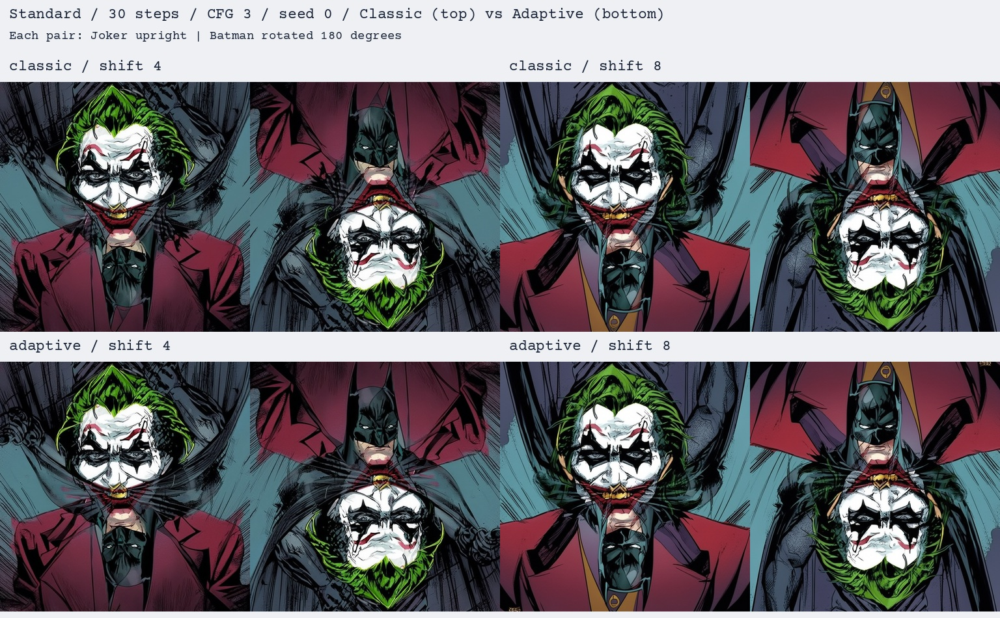

# Standard Iris at 30 steps: adaptive balancing

Two new adaptive images compared with the two cached Classic images at shifts 4 and 8. Standard Iris INT8, 30 DPM steps, order 2, CFG 3, 1024x1024, seed 0 and the same empty negative prompt. No LoRA, MTL or SyncVC. Within each shift, only adaptive balancing is changed. Prompt encodings and initial noise are reused.

| Method | Shift | Joker CLIP | Batman CLIP | Weaker view | Minimum margin | Seconds | Peak GiB |
| --- | ---: | ---: | ---: | ---: | ---: | ---: | ---: |
| classic | 4 | 0.2908 | 0.2388 | 0.2388 | -0.0264 | 387.4 | 6.92 |
| classic | 8 | 0.2859 | 0.2552 | 0.2552 | -0.0047 | 380.5 | 6.92 |
| adaptive | 4 | 0.2889 | 0.2496 | 0.2496 | -0.0314 | 404.9 | 6.92 |
| adaptive | 8 | 0.2782 | 0.2631 | 0.2631 | -0.0018 | 398.9 | 6.92 |

[Rotating four-condition comparison](comparison.mp4)

## Findings

Adaptive balancing improved the weaker-view score at both shifts: 0.2388 to 0.2496 at shift 4 and 0.2552 to 0.2631 at shift 8, approximately 4.5% and 3.1%. Joker alignment decreased slightly in both cases. The minimum prompt margin worsened at shift 4 and improved at shift 8; all four margins remained negative. Shift 8 with adaptive had the strongest weaker-view alignment in this Standard comparison, but the images still place the two faces in separate areas and retain Joker dominance. Adaptive also introduces streak-like details around the mouth/neck region.

The adaptive runs took about 18 seconds longer (roughly 4.5–4.9%); VRAM stayed near 6.92 GiB. There were 12 balancing updates at shift 4 and 10 at shift 8. The improvement is modest and comes from one pair and seed. The selected anagram default is now Standard, 30 steps, guidance 3, shift 8 and adaptive balancing for two geometric views. Classic remains selectable. This profile is the strongest Standard alignment setting in this check, not a universally optimal configuration.

## Conditions and limitations

- `a comic book portrait of the Joker from DC Comics, white face, green hair and a red smile`
- `a comic book portrait of Batman from DC Comics wearing his black pointed-eared cowl`

CPU CLIP ViT-B/32 scores clean previews every two steps below noise level 0.95. Desired weights use softmax(-10*score), bounds [0.25,0.75] and 50% smoothing. Each image starts at equal weights. The ordinary Standard DPM solver is preserved; no attention gradients or variance correction are used.

Held-out CLIP ViT-L/14 evaluates saved clean pixels and is not used to guide generation. Scores measure prompt alignment, not human illusion quality. Negative minimum prompt margin means an orientation prefers the other prompt. One seed and prompt pair do not establish a universal default.

[Scores, schedules, per-step weights, hashes and pinned revisions](results.json). RTX 3060 12 GB. Times include preview scoring and exclude downloads, loading, prompt encoding, warm-up, saving and evaluation. [Original Standard shift comparison](../standard-flow-shift/README.md). Full PNGs are under `results/standard_adaptive_joker_batman_20261025/`.

Reproduce with `python scripts/benchmark_standard_adaptive.py`; the earlier Standard baseline and verified prompt caches are required, and completed runs are reused.
